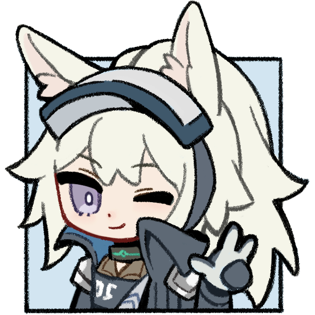

[简体中文](README.md) | [繁體中文](README.zh-Hant.md) | [日本語](README.ja.md) | [한국어](README.ko.md) | [English](README.en.md)

# Arknights Frame Assistant

Welcome to **Arknights Frame Assistant** (AFA), a Windows utility for improving the Arknights PC experience. It provides fully customizable hotkeys, Frame Advance, Quick Actions, and Stronghold Protocol operations.

 

> ⚠️ **Note:** This document and the in-app descriptions are mostly AI-translated and may be inaccurate. Issues and pull requests are welcome to help correct them.

## Contents

- [Download and Start](#download-and-start)
- [Features](#features)
  - [Frame Advance and Precise Operations](#frame-advance-and-precise-operations)
  - [Quick Actions](#quick-actions)
  - [Stronghold Protocol Operations](#stronghold-protocol-operations)
  - [Fully Customizable Hotkeys](#fully-customizable-hotkeys)
  - [Special Operations](#special-operations)
  - [Other Settings](#other-settings)
- [Notes](#notes)
  - [Arknights Process Only](#arknights-process-only)
  - [In-game Key Bindings](#in-game-key-bindings)
  - [In-game Frame Rate](#in-game-frame-rate)
  - [Security Notice](#security-notice)
- [FAQ](#faq)
- [Contributing](#contributing)
- [Declaration](#declaration)
- [Acknowledgements](#acknowledgements)

 

## Download and Start

1. Download the latest executable from the [GitHub Releases page](https://github.com/CloudTracey/arknights-frame-assistant/releases), or from the [AFA official download source (mainland China only)](https://release.arknightsframeassistant.com/latest)
2. Start AFA with the game; either order is supported, or enable automatic startup in settings
3. Customize the hotkeys and settings you want to change
4. Click **Save and Close** or **Apply Settings**. Changes take effect in the game

 

## Features

AFA's settings window is divided into six pages: **Combat**, **Quick Actions**, **Stronghold Protocol**, **Custom Keys**, **Special Operations**, and **Other Settings**. Their main features and settings are described below.

### Frame Advance and Precise Operations

The following hotkey functions and related settings are available on the **Combat** page:

| Feature | Description |
|------|------|
| Pause on Press | Toggle pause on press |
| Pause on Release | Toggle pause on release, recreating the "click" feel of an emulator |
| Toggle Speed | Toggle game speed (1x / 2x) |
| Select While Paused | While paused, click the unit you want to select |
| Skill | Press the skill key |
| Retreat | Press the retreat key |
| Switch Camera | While paused, move the mouse to a unit and click to center the camera on it |
| Frame Advance 16ms | Use while paused; advances game time by 16ms |
| Frame Advance 33ms | Use while paused; advances game time by 33ms |
| Frame Advance 166ms | Use while paused; advances game time by 166ms |
| One-Click Skill | Move the mouse to the unit you want to use a skill on, then press to select and activate the skill automatically |
| One-Click Retreat | Move the mouse to the unit you want to retreat, then press to select and retreat automatically |
| Pause Skill | While paused, hover the unit to skill, then press to select and activate it |
| Pause Retreat | While paused, hover the unit to retreat, then press to select and retreat it |
| In-Game Frame Rate | Choose the tier matching the game's actual frame rate (30 / 60 / 90 / 120 / 144 / 165 / 180 / 240+) so frame-advance delays stay accurate |
| Enable Combat Hotkeys Only in Levels (experimental) | Detects the level screen and disables Combat hotkeys outside it to avoid accidental triggers |

- The actual wait for each of the three "Frame Advance" hotkeys can be adjusted in **Other Settings → Custom**; the hotkey labels and status bar hints update accordingly

### Quick Actions

| Feature | Description |
|------|------|
| Simulate Left Click | Simulate pressing the left mouse button |
| Base Quick Collect | Click the collect button at the bottom-left of the screen to collect base products |
| Abandon Operation | Abandon the current battle |
| Skip Recruit/Story | Quickly move the mouse and click the skip button at the top right |
| Collect IS Items | Quickly move the mouse and click the "Collect" button in Integrated Strategies |
| Back to Previous Menu | Simulate pressing ESC to return to the previous menu |
| Use Back to Cease Operations | Press "Back to Previous Menu" to press the ESC key and the "Abandon Operation" key at the same time |

### Stronghold Protocol Operations

| Feature | Description |
|------|------|
| Check Enemies | View enemy information |
| Dispatch Center | Open the Dispatch Center (shop) |
| Freeze | Freeze the Dispatch Center (shop) |
| Refresh | Refresh the Dispatch Center (shop) |
| Ready | Confirm ready |
| Simulate Left Click | Simulate pressing the left mouse button |
| Upgrade | Upgrade the Dispatch Center (shop) |
| Sell/Destroy | Sell operators / destroy equipment |
| Retreat Unit | Retreat the selected unit |
| One-Click Retreat | Automatically retreat the unit at the mouse position after clicking |
| One-Click Sell/Destroy | Automatically sell/destroy the operator or equipment at the mouse position after clicking |
| One-Click Purchase | Simulate a double left click to buy the unit in the Dispatch Center shop |
| Back to Previous Menu | Simulate pressing ESC to return to the previous menu |

> **Note:** The Stronghold Protocol plan is mutually exclusive with the Combat and Quick Actions plans: while the Stronghold Protocol page is active, Combat and Quick Actions hotkeys are disabled; while the Combat or Quick Actions page is active, Stronghold Protocol hotkeys are disabled

### Fully Customizable Hotkeys

All hotkey functions can be rebound in the settings window; only common Combat functions come with default bindings:

**Default Combat bindings:**

| Feature | Default | Feature | Default |
|------|----------|------|----------|
| Pause on Press | F | Frame Advance 16ms | None |
| Pause on Release | Space | Frame Advance 33ms | R |
| Toggle Speed | D | Frame Advance 166ms | T |
| Select While Paused | W | One-Click Skill | E |
| Skill | S | One-Click Retreat | Q |
| Retreat | A | Pause Skill | Mouse Forward |
| Switch Camera | None | Pause Retreat | Mouse Back |

- Most keyboard keys are supported
- Mouse buttons other than left click are supported, including the wheel and side buttons
- Use `BACKSPACE/DELETE` to clear a binding
- Conflicts are detected in real time and conflicting fields are marked red; resolve them before saving
- The **Reset Keys** button at the bottom of the settings window restores all keys except custom keys to their defaults

**Custom Keys:**

The **Custom Keys** page lets you add up to 12 custom keys: set the key name, type (Global / Combat / Quick / Stronghold Protocol) and function, then click the game window to capture the coordinates where the operation should be performed. Click the gear icon at the end of a row to edit or delete it. The key type determines when it works:

- Global keys: always work
- Combat keys: only inside an operation stage
- Quick keys: always work while the Stronghold Protocol plan is off
- Stronghold Protocol keys: only while the Stronghold Protocol plan is on

### Special Operations

The **Special Operations** page groups opening-stage and game-volume features:

| Feature | Description |
|------|------|
| Auto Pause at Start | Automatically pause when entering a stage; can be toggled at any time with the "Enable/disable auto-pause" hotkey |
| Hold Auto Pause | Hold while a stage loads; the game auto-pauses on entry, whether or not Enable auto pause at start is checked |
| Auto 2x Speed at Start | Automatically switch to 2x speed when entering a stage; can be toggled at any time with the "Enable/disable auto-2x speed" hotkey |
| Increase Volume | Increase the game client volume in the Windows Volume Mixer |
| Decrease Volume | Decrease the game client volume in the Windows Volume Mixer |
| Mute | Toggle the game client mute state |

> **Note:** The hotkeys on the Special Operations page are unbound by default and can be bound there; game volume hotkeys work on every function page

### Other Settings

| Setting | Description |
|------|------|
| **Language** | Switch the interface language between Auto (follow system), Simplified Chinese, Traditional Chinese, Japanese, Korean, and English (US) |
| **Theme** | Switch the interface theme between follow system, light, and dark |
| **Top Tab Management** | In Other Settings → Display, use the eye icons to toggle each tab's visibility and drag to reorder (at least one function tab must remain). Other Settings always remains, and the order and visibility take effect together when saved or applied; the top bar divides evenly among visible tabs |
| **Exit AFA when the Game Process Closes (strongly recommended)** | Exit AFA automatically when all game processes close |
| **Open Settings at Startup** | Open the settings window automatically after AFA starts |
| **Exit AFA when Clicking the Window Close Button** | When checked, clicking the ✗ at the top right of the settings window exits AFA directly; otherwise the window is hidden to the tray (Alt+F4 always exits AFA) |
| **Start with the Stronghold Protocol Plan** | Switch to the Stronghold Protocol plan directly after AFA starts |
| **Start Arknights with AFA** | Start Arknights at the specified path when AFA starts (set the game path first) |
| **Detect Game Path** | Detect all servers' install paths on this PC at once; if nothing is found, start the game first and detect again |
| **Start AFA when Arknights Starts** | Start AFA automatically when Arknights from any server starts (requires an administrator scheduled task) |
| **Multi-Server Support** | Supports CN, Bilibili, Traditional Chinese, Japanese, Korean, and International servers: reads and adapts to each server's in-game key bindings; the Launch & Exit page shows detected server paths and running clients read-only |
| **Update Channel** | The stable channel is more stable but may have a few bugs; the beta channel has more new features and potentially more bugs |
| **Update Source** | Mainland China users should choose Tencent Cloud; users elsewhere should use GitHub. Tencent Cloud is the default and failed checks fall back to the other source |
| **Auto Check for Updates** | Check for updates automatically after AFA starts; you can also check manually or download manually on the Update page |
| **GitHub Token** | Only fill it in and enable it when using the GitHub source and the API quota is exceeded; the token is encrypted with Windows DPAPI for the current user |
| **Click Delay** | Select-to-press delay (ms): 【Skill】【Retreat】, 【Sell/Destroy】 (Stronghold Protocol); too short breaks clicks |
| **Enable/Disable Hotkey Shortcut** | Set the shortcut that quickly enables/disables all hotkeys (click the field to change, `BACKSPACE/DELETE` to clear) |
| **Frame Skip Slots 1 / 2 / 3** | Actual wait (ms) of the three "Frame Advance" hotkeys |
| **Allow Hover Operation when the Game Window is Inactive** | Hover the inactive game window to trigger hotkeys |
| **Logs and Diagnostics** | AFA records logs automatically; on the Log page you can create a redacted log archive, open the log folder, or show the debug log console to view logs in real time |
| **Tray Menu** | Right-click the tray icon to open settings, enable/disable hotkeys, restart AFA, or exit |
| **About** | View the current version, changelog, GitHub repository, feedback & suggestions, QQ group, Bilibili homepage, and icon artist homepage |

 

## Notes

### Arknights Process Only

AFA's hotkey functions act only on the Arknights process (`Arknights.exe`) and do not affect operations outside the game

### In-game Key Bindings

AFA reads the game's key bindings and adapts automatically

If reading fails, AFA shows a warning and falls back to default keys. In that case, please **restore the game's default key settings** to ensure normal operation

### In-game Frame Rate

The "In-Game Frame Rate" option in AFA offers **30 / 60 / 90 / 120 / 144 / 165 / 180 / 240+**. Choose the tier matching the game's actual frame rate so frame-advance delay calculation stays accurate

- If your monitor refresh rate is **120 Hz or above**: VSync may be enabled, and the frame rate tier can be set to 120 or above
- If your monitor refresh rate is **below 120 Hz**: VSync is not recommended; make sure the frame rate setting matches the game's actual frame rate. If VSync is enabled, make sure the setting matches the monitor refresh rate

### Security Notice

AFA is built with AutoHotkey. Anti-cheat systems in most MMORPGs and competitive online games are very sensitive to programs built with AutoHotkey; they may misidentify AFA as a cheat program, preventing the game from starting or even getting the account banned.

**We strongly recommend enabling "Exit AFA when the Game Process Closes"** (enabled by default) so that forgetting to close this tool does not trigger anti-cheat systems in other games.

### If the Settings Window Was Closed

If "Exit AFA when Clicking the Window Close Button" is disabled, find the AFA icon in the taskbar notification area (including hidden icons) and right-click **Open Settings** to reopen the settings window. If it is enabled, clicking X exits the program, and you need to restart AFA

 

## FAQ

### Q: Nothing happens after starting the program?

A: Please check the following:
1. Make sure the program is running with administrator privileges
2. Make sure the game has started
3. Check whether there is an AFA icon in the notification area at the bottom right (including hidden tray icons)
4. Check whether "Open Settings at Startup" has been disabled in settings

### Q: A hotkey does not work after binding?

A: Please check:
1. Whether AFA showed a "game key read failed" prompt (if so, restore the game's default keys)
2. Whether you applied or saved the settings after changing them
3. Whether the key conflicts with other software
4. Whether you are operating inside the game window

### Q: What is a GitHub Token? Do I need to configure it?

A: A GitHub Token is used to raise the API request quota. It is only needed when an API quota-exceeded prompt appears; in general, no configuration is required.

The GitHub Token is encrypted with Windows DPAPI for the current Windows user and is no longer written to the configuration file in plaintext. On the first launch of a new version, the plaintext token from an older version is migrated to the encrypted format automatically; if the configuration file is copied to another Windows user or computer, the token usually needs to be entered again.

### Q: How do I exit AFA completely?

A: You can right-click the tray icon and choose "Exit", or enable **Exit AFA when Clicking the Window Close Button** in the "Launch & Exit" settings and then click the X at the top right of the settings window to exit. If **Exit AFA when the Game Process Closes** is enabled, AFA also exits when the game exits.

### Q: How do I collect logs for reporting a problem?

A: Open the "Log" page in settings, click **Generate Log Archive**, and provide the generated ZIP file with the issue or feedback. Logs are saved under `%AppData%\ArknightsFrameAssistant\PC\logs` by default

 

## Contributing

Issues and pull requests are welcome! Please read [CONTRIBUTING.md](./CONTRIBUTING.md) before contributing

 

## Declaration

- This program is open-sourced under the [GNU General Public License v3.0 only](https://spdx.org/licenses/GPL-3.0-only.html)
- The README format and some GUI styles were borrowed from [MAA](https://github.com/MaaAssistantArknights/MaaAssistantArknights); thanks to the shoulders of giants
- This tool is for learning and communication only; do not use it for commercial purposes

## Acknowledgements

### Project Contributors

Thanks to everyone who contributed code to this project!

### Icon Credit

This project's icon was carefully drawn by **[文件名错误EXE](https://www.mihuashi.com/profiles/8282001?role=painter)**; special thanks

- 🎨 Artist homepage: https://www.mihuashi.com/profiles/8282001?role=painter
- 📜 The icon copyright belongs to the original author, and this project has been authorized to use it (for this open-source project only). The icon is not open-sourced under the above GPL license; please do not misappropriate it.
