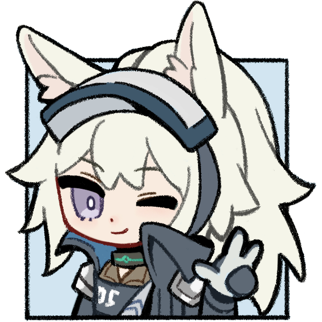

[简体中文](README.md) | [繁體中文](README.zh-Hant.md) | [日本語](README.ja.md) | [한국어](README.ko.md) | [English](README.en.md)

# アークナイツフレーム操作アシスタント ArknightsFrameAssistant

**アークナイツフレーム操作アシスタント**（Arknights Frame Assistant、略称 **AFA**）へようこそ。

すべてのキーをカスタマイズ可能、フレームスキップ操作、堅守協定のワンクリック操作など、アークナイツPC版の体験を向上させるツールです。

 

> ⚠️ **注記：** 本ドキュメントおよびアプリ内の記述は、その大半が AI 翻訳によるものであり、不正確な表現が含まれる可能性があります。修正のための Issue や Pull Request を歓迎します。

## 目次

- [ダウンロードと起動](#ダウンロードと起動)
- [機能一覧](#機能一覧)
  - [フレーム送りと精密操作](#フレーム送りと精密操作)
  - [クイック操作](#クイック操作)
  - [堅守協定操作](#堅守協定操作)
  - [全キーカスタマイズ可能](#全キーカスタマイズ可能)
  - [特殊操作](#特殊操作)
  - [その他の設定](#その他の設定)
- [注意事項](#注意事項)
  - [アークナイツプロセスのみ](#アークナイツプロセスのみ)
  - [ゲーム内キー設定](#ゲーム内キー設定)
  - [ゲーム内フレームレート](#ゲーム内フレームレート)
  - [セキュリティに関する注意](#セキュリティに関する注意)
- [よくある質問](#よくある質問)
- [コントリビューションガイド](#コントリビューションガイド)
- [ライセンス](#ライセンス)
- [クレジット](#-クレジット)

 

## ダウンロードと起動

1. [GitHub Releasesページ](https://github.com/CloudTracey/arknights-frame-assistant/releases)、または [AFA 公式ダウンロードソース（中国本土のみ）](https://release.arknightsframeassistant.com/latest) から最新バージョンのexeファイルをダウンロードします
2. ゲームと一緒に起動します（起動の順番は問いません）、または設定で自動起動を有効にします
3. 変更したいキーや設定をカスタマイズします
4. **保存して閉じる**または**設定を適用**をクリックするとゲーム内で有効になります

 

## 機能一覧

AFA の設定ウィンドウは **通常作戦**・**クイック操作**・**堅守協定**・**カスタムキー**・**特殊操作**・**その他の設定** の 6 ページに分かれています。各ページの主な機能と設定は以下のとおりです。

### フレーム送りと精密操作

**通常作戦**ページで使用できるホットキー機能と関連設定です：

| 機能 | 説明 |
|------|------|
| 押した時にポーズ | 押下時にポーズを切り替えます |
| 離した時にポーズ | 離した時にポーズを切り替え、エミュレーターの「クリック」感を再現します |
| 倍速切替 | ゲームの倍速を切り替えます（1倍/2倍） |
| ポーズ中に選択 | ポーズ中、選択したいユニットをクリックして選択します |
| スキル | スキルキーをクリックします |
| 撤退 | 撤退キーをクリックします |
| 視点切替 | ポーズ中、ユニットにマウスを合わせてクリックするとカメラ中心がそのユニットに切り替わります |
| 16ms進む | ポーズ中に使用し、ゲーム時間を 16ms 進めます |
| 33ms進む | ポーズ中に使用し、ゲーム時間を 33ms 進めます |
| 166ms進む | ポーズ中に使用し、ゲーム時間を 166ms 進めます |
| ワンクリックスキル | スキルを使いたいユニットにマウスを合わせて押すと、自動選択してスキルを発動します |
| ワンクリック撤退 | 撤退させたいユニットにマウスを合わせて押すと、自動選択して撤退させます |
| ポーズスキル | ポーズ中、スキルを使いたいユニットにマウスを合わせて押すと、自動選択してスキルを発動します |
| ポーズ撤退 | ポーズ中、撤退させたいユニットにマウスを合わせて押すと、自動選択して撤退させます |
| ゲーム内フレームレート | ゲームが実際に動作しているフレームレートに合わせて段階（30 / 60 / 90 / 120 / 144 / 165 / 180 / 240+）を選択し、フレーム送りの遅延計算を正確に保ちます |
| ステージ内でのみ通常作戦ホットキーを有効（実験的） | ステージ画面を認識し、ステージ外では通常作戦ホットキーを無効にして誤操作を防ぎます |

- 3 つの「進む」ホットキーの実際の待ち時間は「その他の設定 → カスタム」で調整できます。変更後はホットキー名とステータスバーのヒントも更新されます

### クイック操作

| 機能 | 説明 |
|------|------|
| 左クリックを模擬 | マウスの左ボタンの押下をシミュレートします |
| 基地の高速収集 | 画面左下の基地の収集ボタンをクリックして収集します |
| 作戦放棄 | 現在の戦闘を放棄します |
| 招集演出/ストーリーをスキップ | マウスを高速移動して右上のスキップボタンをクリックします |
| 統合戦略アイテム収集 | マウスを高速移動して統合戦略の「受け取る」ボタンをクリックします |
| 前のメニューへ戻る | ESC キーをシミュレートして前のメニューに戻ります |
| 「上層メニューに戻る」で行動放棄 | 「前のメニューへ戻る」で ESC を押すと同時に「作戦放棄」キーも押します |

### 堅守協定操作

| 機能 | 説明 |
|------|------|
| 敵を確認 | 敵の情報を表示します |
| 管理センター | 管理センター（ショップ）を開きます |
| 凍結 | 管理センター（ショップ）を凍結します |
| 更新 | 管理センター（ショップ）を更新します |
| 準備完了 | 準備完了を確認します |
| 左クリックを模擬 | マウスの左ボタンの押下をシミュレートします |
| レベルアップ | 管理センター（ショップ）をレベルアップします |
| 売却/破棄 | オペレーターを売却、または装備を破棄します |
| ユニット撤退 | 選択中のユニットを撤退させます |
| ワンクリック撤退 | マウス位置のユニットをクリックした後に自動で撤退させます |
| ワンクリック売却/破棄 | マウス位置のオペレーター/装備をクリックした後に自動で売却/破棄します |
| ワンクリック購入 | 左ダブルクリックをシミュレートし、管理センターのショップのユニットを購入します |
| 前のメニューへ戻る | ESC キーをシミュレートして前のメニューに戻ります |

> **注意：** 堅守協定プランは通常作戦・クイック操作プランと排他的です。堅守協定ページに切り替えると通常作戦・クイック操作のホットキーが無効になり、通常作戦またはクイック操作ページに切り替えると堅守協定のホットキーが無効になります

### 全キーカスタマイズ可能

すべてのホットキー機能は設定ウィンドウで再割り当てできます。デフォルトのキーが設定されているのは通常作戦の一部の常用機能のみです：

**通常作戦のデフォルトキー：**

| 機能 | デフォルト | 機能 | デフォルト |
|------|----------|------|----------|
| 押した時にポーズ | F | 16ms進む | なし |
| 離した時にポーズ | Space | 33ms進む | R |
| 倍速切替 | D | 166ms進む | T |
| ポーズ中に選択 | W | ワンクリックスキル | E |
| スキル | S | ワンクリック撤退 | Q |
| 撤退 | A | ポーズスキル | マウスサイドボタン（前） |
| 視点切替 | なし | ポーズ撤退 | マウスサイドボタン（後ろ） |

- キーボード上のほとんどのキーを割り当てられます
- マウスの左ボタンを除く各マウスボタンを割り当てられます（ホイールおよびサイドボタンを含む）
- `BACKSPACE/DELETE` で割り当てを解除できます
- キーの変更時には競合がリアルタイムで検出され、該当する入力欄が赤く表示されます。競合がある場合は、解消するまで保存できません
- 設定ウィンドウ下部の「キーをリセット」で、カスタムキー以外のすべてのキーをデフォルトに戻せます

**カスタムキー：**

「カスタムキー」ページでは最大 12 個のカスタムキーを追加できます。キーの名前、種類（グローバル / 通常作戦 / クイック操作 / 堅守協定）、機能を設定し、ゲームウィンドウをクリックして操作を実行したい座標を取得します。行末の歯車アイコンをクリックすると、いつでも編集・削除できます。キーの種類によって有効範囲が決まります：

- グローバルキー：常に有効
- 通常作戦類：作戦ステージ内でのみ有効
- クイック操作類：堅守協定プランが無効のとき常に有効
- 堅守協定類：堅守協定プランが有効のときのみ有効

### 特殊操作

**特殊操作**ページにはステージ開始時とゲーム音量に関する機能がまとまっています：

| 機能 | 説明 |
|------|------|
| 開幕自動ポーズ | ステージ進入時に自動でポーズします。「開幕自動ポーズの有効/無効」ホットキーでいつでも切り替えできます |
| 押し続け開幕自動ポーズ | ステージ読み込み中に押し続けると、ステージ進入後に自動でポーズします（「開幕自動ポーズを有効化」のチェックに関係なく） |
| 開幕自動倍速 | ステージ進入時に自動で倍速に切り替えます。「開幕自動倍速の有効/無効」ホットキーでいつでも切り替えできます |
| 音量を上げる | Windows の音量ミキサーでゲームクライアントの音量を上げます |
| 音量を下げる | Windows の音量ミキサーでゲームクライアントの音量を下げます |
| ミュート | ゲームクライアントのミュート状態を切り替えます |

> **ヒント：** 「特殊操作」ページのホットキーは既定では未割り当てです。同ページで自由に割り当ててください。ゲーム音量のホットキーはすべての機能ページで有効です

### その他の設定

| 設定 | 説明 |
|------|------|
| **表示言語** | Auto（システム設定に従う）、簡体字中国語、繁体字中国語、日本語、한국어、English (US) の間で UI 言語を切り替えます |
| **画面テーマ** | システムに従う、ライト、ダークの間で画面テーマを切り替えます |
| **トップタブ管理** | 「その他の設定 → 表示」で目のアイコンをクリックして各タブの表示/非表示を切り替え、ドラッグで順序を調整できます（機能タブは最低 1 つ必要）。「その他の設定」は常に残り、保存または適用後に順序と表示状態が同時に反映されます。トップバーは表示中のタブ数に合わせて自動的に等分されます |
| **ゲームプロセス終了時にAFAも終了（推奨）** | すべてのゲームプロセスが終了したら AFA を自動終了します |
| **起動時に設定ウィンドウを開く** | AFA 起動後に設定ウィンドウを自動で開きます |
| **設定ウィンドウを閉じるとAFAを終了** | 有効にすると、設定ウィンドウ右上の ✗ をクリックすると AFA を直接終了します。無効の場合はタスクトレイに格納されます（Alt+F4 では常に AFA を終了します） |
| **デフォルトで堅守協定プランを起動** | AFA 起動後に「堅守協定」プランへ直接切り替えます |
| **AFA起動時にアークナイツを起動** | AFA 起動時に指定パスのアークナイツを自動起動します（先にゲームパスを設定してください） |
| **ゲームパスを検出** | この PC のすべてのサーバーのインストールパスを一括検出します。見つからない場合はゲームを起動してから再検出してください |
| **アークナイツ起動時にAFAを起動** | 任意のサーバーのアークナイツが起動したときに AFA を自動起動します（管理者権限のタスクが必要） |
| **マルチサーバー対応** | 国服・Bilibili 服・繁体字中国語服・日本語服・韓国語服・国際服に対応：各サーバーのゲーム内キー設定を読み取って動的に適応します。「起動と終了」ページには検出済みのサーバーパスと実行中のクライアントが読み取り専用で表示されます |
| **更新チャンネル** | 安定版は比較的安定していますが、少数の BUG が含まれる場合があります。テスト版は新機能が多く、BUG も多い可能性があります |
| **更新ソース** | 中国本土では Tencent Cloud、その他の地域では GitHub をおすすめします。既定は Tencent Cloud で、チェックに失敗すると自動的にもう一方のソースにフォールバックします |
| **自動更新チェック** | AFA 起動後に更新を自動チェックします。「更新」ページから手動での確認や手動ダウンロードも可能です |
| **GitHub Token** | GitHub ソースを使用し、API クォータを超過した場合にのみ入力して有効化してください。Token は現在のユーザー向けに Windows DPAPI で暗号化して保存されます |
| **クリック遅延** | 選択から【スキル】【撤退】、堅守協定の【売却/破棄】を押すまでの間隔（ミリ秒）です。短すぎるとクリックが効かなくなります |
| **「ホットキー有効/無効」ホットキー** | すべてのホットキーをすばやく有効/無効にするホットキーを設定します（入力欄をクリックして変更、`BACKSPACE/DELETE` でクリア） |
| **フレームスキップ1 / 2 / 3** | 3 つの「進む」ホットキーの実際の待ち時間（ミリ秒） |
| **ゲームウィンドウが非アクティブでもホバー操作を許可** | ゲームウィンドウが非アクティブでも、マウスをウィンドウに重ねるとホットキーが発動します |
| **ログと診断** | AFA は実行ログを自動記録します。「ログ」ページで機密情報を除去したログ圧縮パッケージの生成、ログフォルダを開く、デバッグログコンソールを表示してリアルタイムにログを確認できます |
| **タスクトレイメニュー** | トレイアイコンを右クリックすると、設定を開く、ホットキーの有効/無効、AFA の再起動、終了をすばやく実行できます |
| **について** | 現在のバージョン、更新履歴、GitHub リポジトリ、フィードバックと提案、交流 QQ グループ、Bilibili ホームページ、アイコン絵師のホームページを確認できます |

 

## 注意事項

### アークナイツプロセスのみ

AFA のキー機能はアークナイツプロセス（`Arknights.exe`）にのみ作用し、ゲーム以外の操作には影響しません

### ゲーム内キー設定

AFA はゲーム内のキー設定を自動的に読み取り、動的に適応します

自動読み取りに失敗した場合、AFA は通知を表示し、デフォルトキーを使用します。その場合は、正常に動作させるため、**ゲーム内のキー設定を手動でデフォルトに戻してください**

### ゲーム内フレームレート

AFA の「ゲーム内フレームレート」オプションは **30 / 60 / 90 / 120 / 144 / 165 / 180 / 240+** です。フレーム送りの遅延計算を正確にするため、ゲームが実際に動作しているフレームレートと一致する段階を選択してください

- モニターのリフレッシュレートが **120 Hz 以上**の場合：垂直同期を有効にし、フレームレートを 120 以上に設定できます
- モニターのリフレッシュレートが **120 Hz 未満**の場合：垂直同期を無効にし、フレームレート設定をゲームの実際のフレームレートと一致させることを推奨します。垂直同期を有効にする場合は、この設定をモニターのリフレッシュレートと一致させてください

### セキュリティに関する注意

AFA は AutoHotkey で開発されています。ほとんどの MMORPG や競技系オンラインゲームのアンチチートシステムは AutoHotkey 製プログラムに非常に敏感で、チートプログラムと誤判定してゲームが起動できなくなったり、アカウントが停止されたりする可能性があります。

**「ゲームプロセス終了時にAFAも終了」を有効にすることを強くおすすめします**（既定で有効）。このツールを閉じ忘れて他のゲームのアンチチートを誤って作動させないようにするためです。

### 設定画面を閉じた場合

「設定ウィンドウを閉じるとAFAを終了」が無効の場合、画面右下のタスクトレイ（隠れたアイコンを含む）から AFA のアイコンを見つけ、右クリックして**設定を開く**を選ぶと設定画面を再度開けます。有効の場合は X をクリックするとプログラムが終了するため、AFA を再起動してください

 

## よくある質問

### Q: 起動しても反応しません

A：以下の点をご確認ください：
1. プログラムが管理者権限で実行されていることを確認してください
2. ゲームが起動していることを確認してください
3. 右下の通知領域に AFA のアイコンがあるか確認してください（隠れたトレイアイコンも含む）
4. 設定で「起動時に設定ウィンドウを開く」がオフになっていないか確認してください

### Q: キーを割り当てても反応しません

A：以下をご確認ください：
1. AFA が「ゲームキー読み取り失敗」の通知を表示していないか（表示された場合は、ゲーム内のキーを既定に戻してください）
2. 変更後に設定を適用または保存したか
3. キーが他のソフトウェアと競合していないか
4. ゲームウィンドウ内で操作しているか

### Q: GitHub Token とは何ですか。設定が必要ですか

A：GitHub Token は API リクエストのクォータを増やすために使用します。API クォータ超過の通知が表示された場合にのみ設定が必要で、通常は使用する必要はありません。

GitHub Token は現在の Windows ユーザー向けに Windows DPAPI で暗号化して保存され、設定ファイルに平文で書き込まれることはありません。新しいバージョンの初回起動時に、旧バージョンの平文 Token は暗号化形式へ自動的に移行されます。設定ファイルを別の Windows ユーザーや PC にコピーした場合は、通常 Token を再入力する必要があります。

### Q: AFA を完全に終了するには

A：タスクトレイのアイコンを右クリックして「終了」を選択するか、「起動と終了」設定で**設定ウィンドウを閉じるとAFAを終了**を有効にしてから設定ウィンドウ右上の X をクリックすると終了できます。**ゲームプロセス終了時にAFAも終了**が有効な場合は、ゲーム終了時に AFA も自動的に終了します。

### Q: 問題報告用のログを収集するには

A：設定の「ログ」ページを開き、**ログ圧縮パッケージを生成**をクリックして、生成された ZIP ファイルを Issue またはフィードバックに添付してください。ログは既定で `%AppData%\ArknightsFrameAssistant\PC\logs` に保存されます

 

## コントリビューションガイド

Issue と Pull Request を歓迎します！ コントリビューションの前に [CONTRIBUTING.md](./CONTRIBUTING.md) をお読みください

 

## ライセンス

- 本プログラムは [GNU General Public License v3.0 only](https://spdx.org/licenses/GPL-3.0-only.html) でオープンソースとして公開されています
- README のフォーマットと GUI スタイルの一部は [MAA](https://github.com/MaaAssistantArknights/MaaAssistantArknights) を参考にさせていただきました。巨人の肩に感謝します
- 本ツールは学習・交流のみを目的として使用してください。商用利用はご遠慮ください

## 🙏 クレジット

### コントリビューター

本プロジェクトにコードを貢献してくださった皆さまに感謝します！

### アイコンのクレジット

本プロジェクトのアイコンは [**文件名错误EXE**](https://www.mihuashi.com/profiles/8282001?role=painter) 氏が心を込めて描いたものです。ここに感謝します

- 🎨 イラストレーターのホームページ：https://www.mihuashi.com/profiles/8282001?role=painter
- 📜 アイコンの著作権は原作者に帰属し、本プロジェクトは使用許諾を得ています（本オープンソースプロジェクトに限ります）。アイコンは上記 GPL ライセンスでは公開されておらず、無断での転用はご遠慮ください
